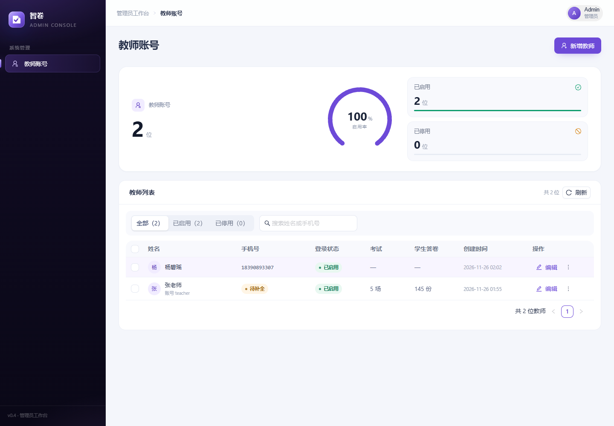
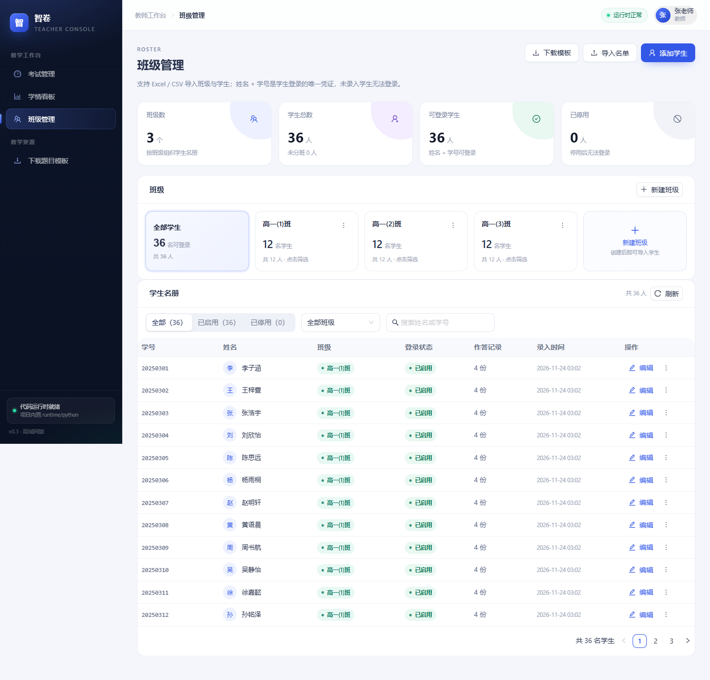
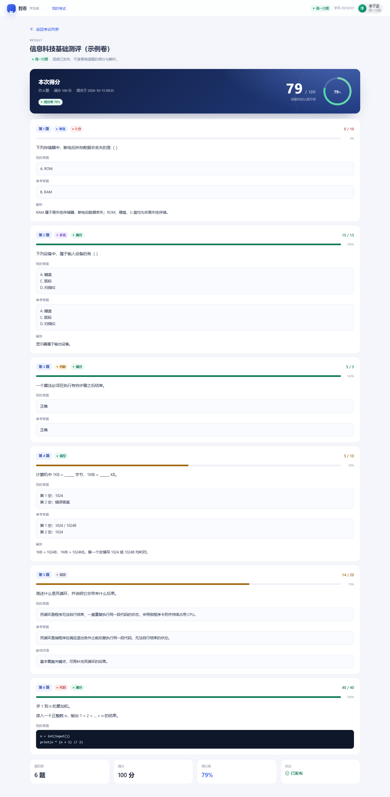
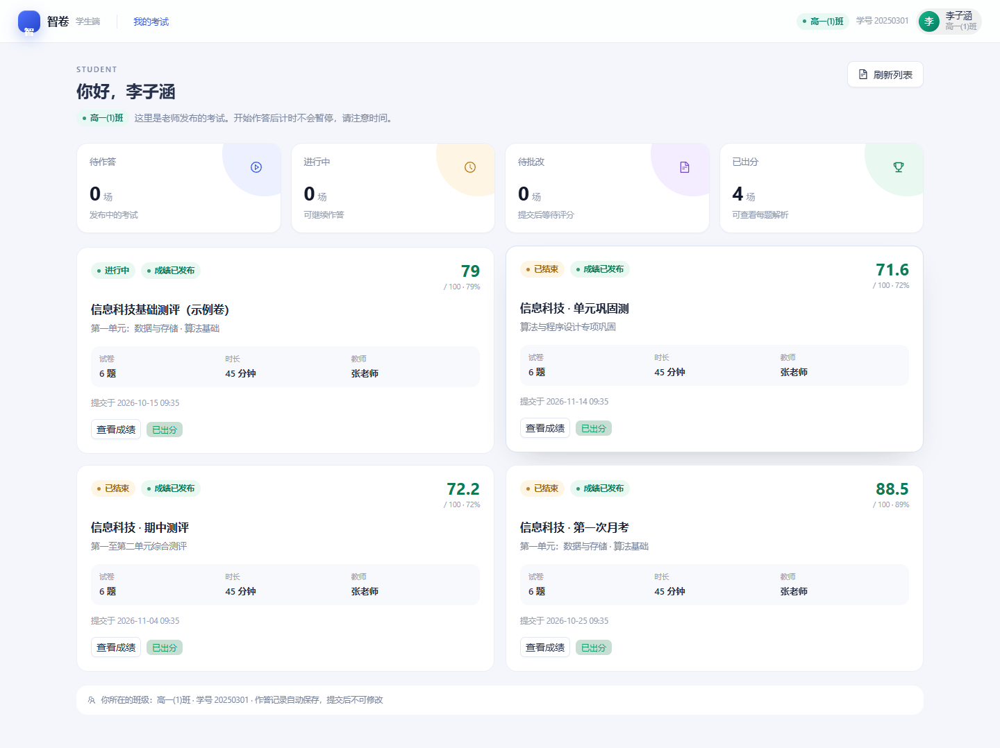

# 智卷 · 在线测评系统（管理员端 + 教师端 + 学生端）

一套面向课堂的「管理员建教师 → 教师出卷 → 学生作答 → 自动阅卷 → 教师校准 → 成绩发布」闭环系统。
管理员统一创建、启停教师账号；教师用 **Word** 出题、用 **Excel** 导入班级学生名册；系统自动解析题型、答案与代码测试点，客观题秒级判分，代码题在真实运行时里跑测试点；教师端可以逐题校准每一分。

> 当前版本：v0.4（单机 / 局域网形态，无需数据库服务、无需 Docker、无需外网）

**技术栈**：React 19 + antd v6 + Tailwind CSS v4 + ECharts 6 + Vite ｜ Fastify 5 + TypeScript ｜ SQLite（node:sqlite）｜ Excel（xlsx）名册导入 ｜ 内置 Python 运行时

---

## 界面预览

**登录入口**（管理员 / 教师 / 学生使用三个独立入口，学生仅支持已录入名册）


**管理员登录**（独立入口，与教师账号相互隔离）


**管理员工作台 · 教师账号**（新增 / 启停 / 批量管理）



**教师登录**（账号 + 密码，账号由管理员创建；账号旁问号可查看账号说明）


**学生登录**（姓名 + 学号，未录入学生无法登录）


**教师端 · 考试管理**（考试概览与建卷入口）


**教师端 · 班级管理**（Excel / CSV 导入名册，管理登录权限）



**教师端 · 学情看板**（按班级 / 学生维度汇总，ECharts 图表汇报）


**学生答题**（答题卡、倒计时、自动保存、代码编辑器与样例）


**学生成绩**（发布后可见每题得分、参考答案与解析）



**学生首页**（显示所属班级、考试状态与成绩）



---

## 1. 功能一览

### 管理员端

| 能力 | 说明 |
| --- | --- |
| 独立入口 | `/admin/login`，管理员与教师账号完全分离；登录后进入独立的管理员工作台 |
| 教师账号 | 新增教师（姓名 + 手机号），自动生成登录账号，初始密码为手机号 |
| 账号管理 | 编辑姓名 / 手机号、启用 / 停用、重置密码、删除；删除有考试的教师需二次确认并连同考试与成绩一起清除，停用则保留数据 |
| 批量操作 | 多选教师后批量启用、批量停用、批量删除 |
| 工作台概览 | 教师总数、启用 / 停用数量、名下考试与答卷统计，支持按状态筛选和姓名 / 手机号搜索 |

### 教师端

| 能力 | 说明 |
| --- | --- |
| 班级管理 | 新建 / 重命名 / 删除班级；Excel、CSV 或手动添加学生；支持编辑、停用、删除与恢复登录 |
| 名册导入 | 按「班级 / 姓名 / 学号」导入 `.xlsx`、`.xls`、`.csv`；自动创建班级、按学号更新学生 |
| 建考试 | 标题、说明、时长（分钟） |
| Word 导入 | 上传 `.docx`，先解析预览、标出错误与警告，确认后再入库 |
| 题目管理 | 查看六种题型、修改分值、删除题目、查看答案与测试点 |
| 发布 / 结束 | 草稿 → 进行中 → 已结束 |
| 批改台 | 学生列表、班级筛选、自动分、最终分、待校准题数，3 秒刷新 |
| 逐题校准 | 改分 + 评语，改动写入审计日志；可一键确认全部自动分 |
| 成绩发布 | 发布后学生可见每题得分、参考答案、解析 |
| 学情看板 | ECharts 图表：成绩分布、班级对比、学生对比、逐题得分率、历次趋势；支持多班级 / 多学生筛选 |
| 学生画像 | 单名学生历次成绩走势、班级排名、最近一次逐题得分与班级平均对比 |

### 学生端

| 能力 | 说明 |
| --- | --- |
| 登录 | 独立 `/student/login`，使用老师录入的姓名 + 学号；未录入或已停用无法登录 |
| 班级与身份 | 顶部与学生首页展示所属班级、学号；教师端可按班统计 |
| 考试列表 | 未开始 / 继续作答 / 批改中 / 查看成绩；已出分考试直接显示得分 |
| 在线作答 | 六种题型、答题卡导航、自动保存草稿、倒计时 |
| 提交 | 二次确认（提示未作答题数），提交后锁定，自动进入评分队列 |
| 成绩 | 发布后可看总分、每题得分、参考答案、教师评语与解析 |

### 评分

| 题型 | 判分方式 | 说明 |
| --- | --- | --- |
| 单选 | 自动 | 选项精确匹配 |
| 多选 | 自动 | 全对才得分（当前版本） |
| 判断 | 自动 | 对 / 错归一化 |
| 填空 | 自动 | 多空独立给分，每空可配置多种可接受写法 |
| 代码 | 自动 | 逐测试点运行、比对 stdout，支持部分分、超时、运行错误 |
| 简答 | 人工 | 教师打分 + 评语，可参考系统给出的自动分 0 基线 |

---

## 2. 快速开始

### 环境要求

- Node.js **22+**（开发验证版本 22.19）
- pnpm **10+**
- Windows / macOS / Linux 均可；Windows 上无需安装 Python（项目自带运行时）

### 启动

```bash
pnpm install
pnpm build     # 构建前端到 dist/
pnpm start     # 启动服务，默认 8787 端口
```

打开 <http://127.0.0.1:8787>。

开发模式（前端热更新 + 后端自动重启）：

```bash
pnpm dev       # Vite :5173（/api 代理到 :8787）+ tsx watch
```

### 登录地址

- 管理员：<http://127.0.0.1:8787/admin/login>
- 教师：<http://127.0.0.1:8787/teacher/login>
- 学生：<http://127.0.0.1:8787/student/login>
- 入口选择页：<http://127.0.0.1:8787/login>

### 默认账号

| 角色 | 登录方式 | 密码 | 说明 |
| --- | --- | --- | --- |
| 管理员 | `admin` | `yby19980523` | 首次启动自动创建，右上角显示 `Admin`；负责管理教师账号 |
| 教师 | 手机号 | 手机号（初始） | 由管理员在「教师账号」中创建，教师不能自行注册 |
| 学生 | 姓名 + 学号 | 无 | 例：`李子涵 / 20250301`、`王梓萱 / 20250302`；仅名册中的学生可登录 |

> 旧版本升级时，原来的 `admin` 教师账号会升级为独立管理员（默认密码升级为 `yby19980523`），历史考试自动转到一个教师账号（用户名 `teacher`，密码沿用旧密码），可在管理员工作台中补全手机号后重置密码。
>
> 演示学生按学号顺序分班：`20250301`–`20250312` 高一(1)班，`20250313`–`20250324` 高一(2)班，`20250325`–`20250336` 高一(3)班。可在教师端「班级管理」中查看、导入或调整。

### 数据存放

所有数据在 `data/app.db`（SQLite 单文件）。删除 `data/` 目录后重启即可恢复初始状态并重新灌入演示账号、班级与 36 名学生。

---

## 3. 五分钟走完一遍

1. 打开 <http://127.0.0.1:8787/admin/login>，用 `admin / yby19980523` 登录管理员工作台。
2. 在「教师账号」中点 **新增教师**，填写姓名和手机号（例如 `张老师 / 13800000001`）；该教师的登录账号和初始密码都是手机号。
3. 退出管理员，打开 <http://127.0.0.1:8787/teacher/login>，用刚才的手机号登录教师工作台，点 **新建考试**。
4. 进入试卷页，点 **使用示例模板试导入**（等价于上传 `templates/题目模板.docx`）。
5. 检查解析预览：6 题、100 分、0 错误 → **确认导入**。
6. 点 **发布考试**。
7. 退出，打开 <http://127.0.0.1:8787/student/login>，用 `李子涵 / 20250301` 登录，进入考试作答（代码题已内置 Python 起始模板）。
8. 提交后等待几秒，自动评分完成。
9. 回到教师端 **批改与出分**：能看到自动分、代码题每个测试点的通过情况；给简答题打分。
10. **发布成绩**，学生端即可看到每题得分与解析。
11. 打开 **学情看板**：选择考试、班级、学生，查看成绩分布、班级对比、学生对比与逐题分析；点击学生「画像」查看个人趋势。
12. 打开 **班级管理**：可下载 Excel 模板，导入新的班级与学生；只有名册中的学生才能登录。

### 教师账号管理

- 入口：管理员登录后的「教师账号」工作台。
- 新增教师：填写 **姓名 + 手机号**；手机号同时作为登录账号和初始密码。
- 编辑教师：只改姓名不影响登录；修改手机号会同步更新账号并把密码重置为新手机号。
- 停用 / 启用：停用后教师无法登录，历史考试与成绩保留；可随时恢复。
- 删除教师：没有考试记录的直接删除；名下有考试的需二次确认，确认后会连同该教师的考试、学生答卷与成绩一起永久删除。只想保留数据时请使用「停用」。
- 批量操作：勾选多位教师后可批量启用、批量停用、批量删除。
- 重置密码：把教师密码重置为当前手机号（教师忘记密码时使用）。

### 班级管理与学生导入

- 入口：教师端侧边栏「班级管理」。
- 模板列：**班级 / 姓名 / 学号**；支持 `.xlsx`、`.xls`、`.csv`。
- 也支持「一个工作表就是一个班级」：表头写姓名、学号，工作表名作为班级名。
- 学号是学生唯一标识：同一文件内重复会报错并整批不写入；数据库已存在相同学号则更新姓名与班级。
- 导入后学生立即可用 **姓名 + 学号** 登录；停用学生无法登录，历史成绩仍保留。
- 新增/编辑学生时可以修改姓名、学号、班级；已有作答记录的学生删除时会自动改为停用。

想直接体验有多班对比数据的看板，可先运行一次演示数据脚本（需要数据库中已有一场含题目的考试，脚本会再创建 3 场历史考试并为 36 名学生生成成绩）：

```bash
pnpm demo:data
```

命令行也可以完整跑一遍（含错误答卷校验与看板接口校验）：

```bash
pnpm smoke
```

### 学情看板怎么用

- **统计口径**：只统计已完成自动评分（`graded`）的答卷；在批改台点「确认全部自动分」后，所有自动分即成为最终分。
- **筛选**：考试单选；班级、学生均可多选。选择学生后，整页 KPI、班级对比、题目分析都会收敛到所选学生。
- **图表**：成绩分布、历次平均分趋势、班级平均分 / 及格率 / 优秀率、班级分数段构成、逐题得分率、题型雷达图。
- **学生对比**：未选学生时展示 8 位覆盖各分数段的代表学生；选中学生后展示所选学生的总分与逐题得分对比（图表最多展示 8 人）。
- **学生画像**：点击「画像」查看个人历次得分率走势、班级平均对比、最近一次逐题得分和考试记录。
- **导出**：右上角「导出成绩」下载当前筛选口径的 CSV（带 BOM，可直接用 Excel 打开）。

---

## 4. Word 试卷导入

导入支持两种格式，上传后自动识别，完整规则见 [docs/word-template.md](docs/word-template.md)。

| 格式 | 适用场景 | 答案位置 |
| --- | --- | --- |
| **真实试卷格式** | 学校现成的练习卷：`综合题一：<材料>（23分）` + 小题，题干末尾写 `（单选题，2分）` | 单独的「参考答案」docx，导入时一起上传 |
| **模板格式** | 自建题目：每题以 `【题型】` 开头 | 与题目同一文件 |

真实试卷格式会保留「大题」结构：材料（含图片、表格）在示例卷里由该组小题共用，学生端与批改台只展示一次；
`选填题` / `匹配题` 按填空处理，`编程题` 没有测试点时由教师按参考代码评分。
多选支持「漏选每个扣 X 分」，填空支持「每空 M 分 / 第一空 A 分，第二空 B 分」，标了「言之有理即给分」的空自动转人工评分。

### 4.1 模板格式：最小规则

模板文件：`templates/题目模板.docx`（教师端首页与试卷页均可下载，接口 `GET /api/template.docx`）。

生成模板（需要 python-docx，非必需，仓库内已带成品）：

```bash
pnpm template
```

- 每道题以 `【题型】` 开头，题型支持：`单选`、`多选`、`判断`、`填空`、`简答`、`代码`（`编程题`、`单选题` 等同义写法也识别）。
- 分值写在题干末尾 `（10分）`，或单独一行 `分值：10`。
- 选项每行一个 `A. xxx`，也支持一行写多个 `A. … B. …`。
- 答案行 `答案：…`；解析行 `解析：…`（可选）。
- 代码题额外使用 `语言：`、`说明：`、`样例输入：`、`样例输出：`、`测试点：`。

### 4.2 模板格式：六种题型写法

```text
【单选】1. 断电后数据会丢失的是（　　）（10分）
A. ROM
B. RAM
C. 硬盘
D. U 盘
答案：B
解析：RAM 属于易失性存储器。

【多选】2. 属于输入设备的有（　　）（15分）
A. 键盘　　B. 显示器　　C. 鼠标　　D. 扫描仪
答案：A,C,D

【判断】3. 算法必须在有穷步内结束。（5分）
答案：对

【填空】4. 1KB = ______ 字节，1MB = ______ KB。（10分）
答案：1024 | 1024B || 1024

【简答】5. 简述什么是死循环。（20分）
参考答案：程序在满足退出条件前反复执行同一段代码……

【代码】6. 求 1 到 n 的累加和。（40分）
语言：Python
说明：读入一个正整数 n，输出 1+2+…+n。
样例输入：10
样例输出：55
测试点：
输入=7 | 输出=28 | 10分 | 公开
输入=1 | 输出=1 | 10分
输入=100000 | 输出=5000050000 | 20分
```

### 4.3 模板格式：关键语法

| 场景 | 写法 |
| --- | --- |
| 一个空有多个正确写法 | `答案：1024 \| 1024B` |
| 多个空 | `答案：1024 \| 1024B \|\| 1024`（`\|\|` 分隔空，`\|` 分隔同空写法） |
| 测试点多行输入 | `输入=3\n1 2 3 \| 输出=6 \| 10分`（`\n` 表示换行） |
| 公开测试点 | 行尾加 `公开`，学生端可见输入输出 |
| 不给测试点分值 | 剩余分数平均分配 |

完整语法、边界情况与报错对照见 [docs/word-template.md](docs/word-template.md)。

### 4.4 真实试卷格式（综合题 + 参考答案）

试卷与参考答案分成两份 docx，一起拖进「导入 Word 试卷」即可自动合并：

```text
# 试卷 docx
综合题一：为了研究不同月季品种的生长特征……请结合所学知识，分析以下问题。（23分）
1.……属于（   ）。（单选题，2分）
A.数据        B.信息        C.知识        D.概念
2.……最多可存储的照片数量为            。（填空题，3分）

# 参考答案 docx
综合题一（23分）
1.（2分）C
2.（3分）85
4.（6分，每空2分）
第一空：有损压缩
第二空：压缩率高/大幅节省存储空间（言之有理即给分）
5.（3分）BCD（漏选1个扣1分）
```

- 大题标记 `综合题一：…（23分）`（也认 `第X大题`）→ 材料由该组小题共用，只展示一次。
- 题型写在题干末尾：`（单选题，2分）`、`（填空题，6分，每空2分）`、`（选填题，2分）`、`（匹配题，6分，每框2分）`、`（编程题，6分）`。
- 参考答案按「大题序号 + 题号」配对；填空用 `第一空：`，匹配题用 `A→②`，编程题用 `参考代码如下`。
- 直接拿真实卷子试解析：

```bash
pnpm exec tsx scripts/test-import.ts "试卷.docx" "参考答案.docx"
```

---

## 5. 评分规则

- **归一化**：填空与简答比对前做 NFKC（全角→半角）、空白折叠、去首尾空格、忽略大小写；填空题再忽略全部空白比一次（`event = "x"` 与 `event="x"` 等价）。
- **选择题**：单选严格相等；多选默认「全对得分」，参考答案标了「漏选每个扣 X 分」时，只漏选（没选错）按漏选个数扣分，选了错误选项记 0 分。
- **填空题**：逐空判断，支持同一空多个可接受答案（`kinds/data.index`）；分值可逐空指定（`每空 M 分` / `第一空 A 分，第二空 B 分`），缺省按满分平均分配。
- **匹配题**：按框判分（每框一个空）。
- **人工评分标记**：简答题、没有测试点的代码题、含「言之有理即给分」空的填空题标为「需人工评分」；自动分只统计能自动判的部分，教师在批改台补分。
- **代码题**：
  - 逐测试点执行，`stdout` 归一化后与期望输出比较（忽略行尾空白、末尾空行、`\r\n`）；
  - 超时（默认 2000ms/测试点）、非零退出码、输出不符均记 0 分；
  - 按测试点分值累加，支持部分分；隐藏测试点的输入输出不下发学生端。
- **简答题**：自动分为 0，必须教师打分。
- **最终分**：默认等于自动分；教师改分后以改分为准；每次改分写 `audit_logs`。

---

## 6. 代码运行时

### 支持语言

- `python`（默认）
- `javascript`（Node 直接执行）

### Python 检测顺序

1. 环境变量 `PYTHON_BIN`
2. 项目内置 `runtime/python/python.exe`（仓库已带 Python 3.12.10 embeddable）
3. 系统 `PATH` 中的 `python` / `python3`

启动时控制台会打印运行时状态；若未检测到 Python，教师端首页会显示错误提示，代码题将无法评测。

> `runtime/` 已被 `.gitignore` 忽略（避免把二进制塞进仓库）。重新 clone 或换机器时，请把 Python 放到 `runtime/python/`，或设置 `PYTHON_BIN`，或直接使用系统 Python。

### 执行方式

每个测试点：临时目录写入源码 → 子进程执行（`-I` 隔离模式）→ 注入 stdin → 限时 → 收集 stdout/stderr（上限 256KB）→ 结束即清理目录。

### 安全边界（重要）

当前是**可信内网 / 教学环境**模式：进程级隔离 + 超时 + 临时目录 + 输出上限，**没有**容器级隔离、网络隔离与内存硬限制。

- 适用：机房内、有监考、无外网的学生作答。
- 不适用：公网暴露、不可信代码来源。
- 升级路径：实现 `CodeRunner` 的 Docker 适配器（`--network none --read-only --memory 256m --pids-limit 64`），业务层无需改动。

---

## 7. 项目结构

```text
yby/
├─ server/                  # Fastify + TypeScript 后端
│  ├─ index.ts              # 启动、静态托管、SPA 兜底、错误处理
│  ├─ db.ts                 # SQLite schema、种子数据、查询辅助
│  ├─ auth.ts / password.ts # 会话 Cookie、scrypt 口令
│  ├─ http.ts               # 守卫、考试归属校验、审计
│  ├─ serialize.ts          # 行 → DTO
│  ├─ import/docx.ts        # Word 解析（模板格式 + 格式分发）
│  ├─ import/paper.ts       # 真实试卷格式解析（综合题材料 + 参考答案合并）
│  ├─ import/html.ts        # mammoth → HTML 块 的公共工具
│  ├─ import/students.ts    # Excel / CSV 学生名册解析与模板生成
│  ├─ runner/run.ts         # Python / Node 执行器
│  ├─ grading/worker.ts     # 评分队列 worker
│  └─ routes/               # auth / admin / teacher / classes / analytics / student
├─ shared/                  # 前后端共用类型与纯函数判分
│  ├─ types.ts
│  └─ grading.ts
├─ src/                     # React 前端
│  ├─ charts/               # ECharts 按需注册与通用图表组件
│  ├─ pages/Login.tsx       # 入口选择 / 管理员登录 / 教师登录 / 学生登录
│  ├─ pages/admin/          # 管理员工作台（教师账号管理）
│  ├─ pages/teacher/        # 考试、试卷、批改、学情看板、班级管理、学生画像
│  ├─ pages/student/        # 考试列表、作答、成绩
│  ├─ ui.tsx / styles.css   # antd 主题、布局与全局样式
│  └─ api.ts / auth.tsx / format.ts
├─ scripts/
│  ├─ make_template.py      # 生成 Word 模板
│  ├─ test-import.ts        # 解析自检
│  ├─ seed-demo.mjs         # 可选：生成多班看板演示数据
│  ├─ analytics-check.mjs   # 看板 / 响应式视觉巡检
│  ├─ ui-check.mjs          # 浏览器级端到端检查
│  └─ smoke.ps1             # 端到端冒烟
├─ templates/题目模板.docx
├─ runtime/python/          # 内置 Python 运行时（可删除，改用系统 Python）
├─ docs/
└─ data/app.db              # 运行时生成
```

架构、数据模型与扩展方式见 [docs/architecture.md](docs/architecture.md)。

---

## 8. 常用命令

| 命令 | 作用 |
| --- | --- |
| `pnpm dev` | 开发模式（Vite 5173 + API 8787） |
| `pnpm build` | 构建前端 |
| `pnpm start` | 生产模式单端口启动（8787） |
| `pnpm typecheck` | TypeScript 全量类型检查 |
| `pnpm template` | 重新生成 Word 模板（需 python-docx） |
| `pnpm import:test` | 只测 Word 解析（打印每题解析结果） |
| `node scripts/e2e-real-paper.mjs` | 真实卷端到端校验：导入两份 docx → 发布 → 作答 → 自动判分（临时库，不影响 `data/app.db`） |
| `node scripts/visual-check-real-paper.mjs` | 真实卷浏览器视觉校验（导入预览、学生答题、批改台、成绩页），截图输出到 `shots/real-paper/` |
| `pnpm demo:data` | 可选：生成 3 场历史考试与 36 名学生成绩，用于体验学情看板 |
| `pnpm demo:reset` | 强制重建演示数据（会覆盖已有提交，仅用于演示库） |
| `pnpm smoke` | 接口级端到端冒烟（含错误答卷与看板接口校验，需服务运行中） |
| `node scripts/ui-check.mjs` | 浏览器级端到端检查（Playwright + 本机 Edge；需空库并先运行 `demo-setup.ps1`，输出截图到 `shots/`） |
| `node scripts/analytics-check.mjs` | 登录/看板/班级管理 + 响应式视觉巡检（输出截图到 `audit/`，建议先运行 `pnpm demo:data`） |
| `pwsh scripts/demo-setup.ps1` | 空库时生成一场示例考试 |

多层自检覆盖不同风险：`pnpm typecheck` 管类型；`pnpm import:test` 管 Word 解析（模板格式与真实试卷格式都覆盖）；`node scripts/e2e-real-paper.mjs` 管真实卷导入与部分分判分；`pnpm smoke` 管接口、判分链路与看板接口；`node scripts/ui-check.mjs` 用真实浏览器跑完「发布 → 作答 → 自动评分 → 人工改分 → 发布成绩」并截图；`node scripts/analytics-check.mjs` 管双登录入口、班级管理、看板图表、筛选、学生画像与移动端布局。

环境变量：

| 变量 | 默认值 | 说明 |
| --- | --- | --- |
| `PORT` | `8787` | 服务端口 |
| `HOST` | `0.0.0.0` | 监听地址（局域网访问需要） |
| `DATA_DIR` | `./data` | SQLite 与密钥目录 |
| `PYTHON_BIN` | 自动探测 | 指定 Python 可执行文件 |
| `ZHIJUAN_BASE` | `http://127.0.0.1:8787` | `smoke.ps1` / `demo-setup.ps1` 访问的服务地址（便于对临时端口做自检） |

---

## 9. 接口一览

| 方法 | 路径 | 说明 |
| --- | --- | --- |
| POST | `/api/auth/admin/login` | 管理员登录（账号 + 密码） |
| POST | `/api/auth/teacher/login` | 教师登录（账号 + 密码） |
| POST | `/api/auth/student/login` | 学生登录（姓名 + 学号，仅已录入且启用） |
| POST | `/api/auth/logout` | 退出 |
| GET | `/api/auth/me` | 当前用户 |
| GET | `/api/auth/runtime` | 代码运行时状态（教师 / 管理员） |
| GET | `/api/admin/overview` | 教师账号列表与统计 |
| POST | `/api/admin/teachers` | 新增教师（姓名 + 手机号） |
| PATCH/DELETE | `/api/admin/teachers/:id` | 编辑 / 停用 / 删除教师（删除有考试的教师需 `?purge=1`） |
| POST | `/api/admin/teachers/:id/reset-password` | 重置密码为手机号 |
| POST | `/api/admin/teachers/batch` | 批量启用 / 停用 / 删除（删除有考试的教师需 `purge: true`） |
| GET | `/api/template.docx` | 下载题目模板 |
| GET/POST | `/api/teacher/exams` | 列表 / 新建 |
| GET/PATCH/DELETE | `/api/teacher/exams/:id` | 详情 / 修改 / 删除草稿 |
| POST | `/api/teacher/exams/:id/import` | 解析 Word（multipart，可同时传试卷 + 参考答案；或 `{"sample":true}`） |
| PUT | `/api/teacher/exams/:id/questions` | 整卷写入（覆盖） |
| PATCH/DELETE | `/api/teacher/questions/:id` | 改分 / 删题 |
| POST | `/api/teacher/exams/:id/publish` | 发布 |
| POST | `/api/teacher/exams/:id/close` | 结束 |
| POST | `/api/teacher/exams/:id/publish-results` | 发布 / 撤回成绩 |
| GET | `/api/teacher/exams/:id/submissions` | 提交列表 |
| GET | `/api/teacher/submissions/:id` | 单份答卷（含自动评分证据） |
| PATCH | `/api/teacher/answers/:id` | 人工改分 |
| POST | `/api/teacher/exams/:id/confirm-auto` | 一键确认自动分 |
| GET | `/api/teacher/classes/overview` | 班级与学生名册概览 |
| POST | `/api/teacher/classes` | 新建班级 |
| PATCH/DELETE | `/api/teacher/classes/:id` | 重命名 / 删除空班级 |
| POST | `/api/teacher/students` | 手动添加学生 |
| PATCH/DELETE | `/api/teacher/students/:id` | 编辑 / 停用或删除学生 |
| GET | `/api/teacher/students/template.xlsx` | 下载学生名册 Excel 模板 |
| POST | `/api/teacher/students/import` | 导入 `.xlsx/.xls/.csv` 名册（multipart） |
| GET | `/api/teacher/analytics/meta` | 看板筛选项：考试、班级、学生 |
| GET | `/api/teacher/analytics` | 学情看板数据（`examId`、`classIds`、`studentIds`） |
| GET | `/api/teacher/students/:id/profile` | 学生画像（历次成绩、班级排名、逐题对比） |
| GET | `/api/student/exams` | 学生考试列表 |
| GET | `/api/student/exams/:id` | 取卷（首次自动创建作答记录） |
| PUT | `/api/student/submissions/:id/draft` | 保存草稿 |
| POST | `/api/student/submissions/:id/submit` | 提交并触发评分 |
| GET | `/api/student/submissions/:id` | 成绩 / 批改进度 |

> `/api/auth/login` 保留为教师登录兼容别名；管理员请使用 `/api/auth/admin/login`，学生请使用 `/api/auth/student/login`。

---

## 10. 已知限制

- 单进程部署，未做并发压测；评分 worker 串行执行（一个测试点跑完再跑下一个）。
- 代码执行无容器隔离，见「安全边界」。
- 题目内容目前只能通过重新导入修改（会覆盖整卷）；已有人提交时禁止重新导入/删题。
- 多选题暂不支持「漏选得半分」配置。
- 简答题没有自动评分（预留了 AI 辅助的接入点）。
- 学生登录采用「姓名 + 学号」课堂信任模式，未设置独立密码；公网部署前应增加密码、验证码或统一身份认证。
- 名册导入支持 `.xlsx / .xls / .csv`，暂不包含照片、家长联系方式等字段；单次最多 5000 人。
- 已有作答记录的学生无法直接物理删除，会转为停用并保留历史成绩；可在名册中恢复。
- 管理员目前只有内置 `admin` 一个账号，界面暂不支持新增管理员或修改管理员密码。
- 教师账号暂不支持批量导入，需要管理员在「教师账号」中逐个新增；手机号是教师唯一登录标识，不支持一个手机号对应多个教师。
- 学情看板只统计已完成自动评分的答卷；评分进行中的答卷不会出现在统计里。
- 班级目前是统计与登录名册维度，考试仍面向全体学生发布，尚未做「按班发布 / 按班限权」。
- 成绩暂无 Excel 导出（看板提供 CSV 导出）、无题库沉淀与组卷。
- 倒计时到点自动提交依赖学生页面仍打开；服务端以提交时间为准做兜底校验。
- 未启用 HTTPS；局域网内认证 Cookie 明文传输（内网场景可接受，公网需加 TLS）。

## 11. 后续路线

1. 代码沙箱升级为 Docker（`--network none`、只读根、内存/CPU/PID 限制）。
2. 支持 C++/Java（镜像与编译链路）。
3. 题库与组卷、Excel 成绩导出、按班发布考试。
4. 学生登录增加密码 / 验证码 / 统一身份认证，并支持二维码或名单链接登录。
5. 简答题 AI 辅助评分（建议分 + 教师确认，仍以人工为准）。
6. 题目在线编辑（不依赖 Word）与图片粘贴上传。
7. 学情看板增加知识点 / 能力维度标签与跨考试班级追踪。
