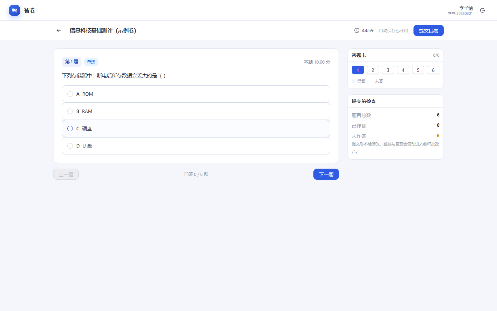

# 智卷 · 信息科技在线测评系统

一套面向课堂的「教师出卷 → 学生作答 → 自动阅卷 → 教师校准 → 成绩发布」闭环系统。
教师用 **Word** 出题，系统自动解析题型、答案与代码测试点；客观题秒级判分，代码题在真实运行时里跑测试点；教师端可以逐题校准每一分。

> 当前版本：v0.1（单机 / 局域网形态，无需数据库服务、无需 Docker、无需外网）

**技术栈**：React 19 + antd v6 + Tailwind CSS v4 + Vite ｜ Fastify 5 + TypeScript ｜ SQLite（node:sqlite）｜ 内置 Python 运行时

---

## 界面预览

**登录**（教师与学生同一入口，登录后自动进入对应工作台）


**教师端 · 考试管理**（顶部实时显示代码运行时状态）


**学生答题**（答题卡、倒计时、自动保存、代码编辑器与样例）



**学生成绩**（发布后可见每题得分、参考答案与解析）


---

## 1. 功能一览

### 教师端

| 能力 | 说明 |
| --- | --- |
| 建考试 | 标题、说明、时长（分钟） |
| Word 导入 | 上传 `.docx`，先解析预览、标出错误与警告，确认后再入库 |
| 题目管理 | 查看六种题型、修改分值、删除题目、查看答案与测试点 |
| 发布 / 结束 | 草稿 → 进行中 → 已结束 |
| 批改台 | 学生列表、自动分、最终分、待校准题数，3 秒刷新 |
| 逐题校准 | 改分 + 评语，改动写入审计日志；可一键确认全部自动分 |
| 成绩发布 | 发布后学生可见每题得分、参考答案、解析 |

### 学生端

| 能力 | 说明 |
| --- | --- |
| 考试列表 | 未开始 / 继续作答 / 批改中 / 查看成绩 |
| 在线作答 | 六种题型、答题卡导航、自动保存草稿、倒计时 |
| 提交 | 二次确认（提示未作答题数），提交后锁定，自动进入评分队列 |
| 成绩 | 发布后可看总分、每题得分、参考答案、教师评语与解析 |

### 评分

| 题型 | 判分方式 | 说明 |
| --- | --- | --- |
| 单选 | 自动 | 选项精确匹配 |
| 多选 | 自动 | 全对才得分（当前版本） |
| 判断 | 自动 | 对 / 错归一化 |
| 填空 | 自动 | 多空独立给分，每空可配置多种可接受写法 |
| 代码 | 自动 | 逐测试点运行、比对 stdout，支持部分分、超时、运行错误 |
| 简答 | 人工 | 教师打分 + 评语，可参考系统给出的自动分 0 基线 |

---

## 2. 快速开始

### 环境要求

- Node.js **22+**（开发验证版本 22.19）
- pnpm **10+**
- Windows / macOS / Linux 均可；Windows 上无需安装 Python（项目自带运行时）

### 启动

```bash
pnpm install
pnpm build     # 构建前端到 dist/
pnpm start     # 启动服务，默认 8787 端口
```

打开 <http://127.0.0.1:8787>。

开发模式（前端热更新 + 后端自动重启）：

```bash
pnpm dev       # Vite :5173（/api 代理到 :8787）+ tsx watch
```

### 演示账号

| 角色 | 账号 | 密码 | 说明 |
| --- | --- | --- | --- |
| 教师 | `teacher` | `123456` | 张老师 |
| 学生 | `s01` ~ `s36` | `123456` | 高一(3)班 36 人，也可用学号登录（如 `20250301`） |

### 数据存放

所有数据在 `data/app.db`（SQLite 单文件）。删除 `data/` 目录后重启即可恢复初始状态并重新灌入演示账号。

---

## 3. 五分钟走完一遍

1. 用 `teacher / 123456` 登录，点 **新建考试**。
2. 进入试卷页，点 **使用示例模板试导入**（等价于上传 `templates/题目模板.docx`）。
3. 检查解析预览：6 题、100 分、0 错误 → **确认导入**。
4. 点 **发布考试**。
5. 退出，用 `s01 / 123456` 登录，进入考试作答（代码题已内置 Python 起始模板）。
6. 提交后等待几秒，自动评分完成。
7. 回到教师端 **批改与出分**：能看到自动分、代码题每个测试点的通过情况；给简答题打分。
8. **发布成绩**，学生端即可看到每题得分与解析。

命令行也可以完整跑一遍（含错误答卷校验）：

```bash
pnpm smoke
```

---

## 4. Word 题目模板

模板文件：`templates/题目模板.docx`（教师端首页与试卷页均可下载，接口 `GET /api/template.docx`）。

生成模板（需要 python-docx，非必需，仓库内已带成品）：

```bash
pnpm template
```

### 4.1 最小规则

- 每道题以 `【题型】` 开头，题型支持：`单选`、`多选`、`判断`、`填空`、`简答`、`代码`（`编程题`、`单选题` 等同义写法也识别）。
- 分值写在题干末尾 `（10分）`，或单独一行 `分值：10`。
- 选项每行一个 `A. xxx`，也支持一行写多个 `A. … B. …`。
- 答案行 `答案：…`；解析行 `解析：…`（可选）。
- 代码题额外使用 `语言：`、`说明：`、`样例输入：`、`样例输出：`、`测试点：`。

### 4.2 六种题型写法

```text
【单选】1. 断电后数据会丢失的是（　　）（10分）
A. ROM
B. RAM
C. 硬盘
D. U 盘
答案：B
解析：RAM 属于易失性存储器。

【多选】2. 属于输入设备的有（　　）（15分）
A. 键盘　　B. 显示器　　C. 鼠标　　D. 扫描仪
答案：A,C,D

【判断】3. 算法必须在有穷步内结束。（5分）
答案：对

【填空】4. 1KB = ______ 字节，1MB = ______ KB。（10分）
答案：1024 | 1024B || 1024

【简答】5. 简述什么是死循环。（20分）
参考答案：程序在满足退出条件前反复执行同一段代码……

【代码】6. 求 1 到 n 的累加和。（40分）
语言：Python
说明：读入一个正整数 n，输出 1+2+…+n。
样例输入：10
样例输出：55
测试点：
输入=7 | 输出=28 | 10分 | 公开
输入=1 | 输出=1 | 10分
输入=100000 | 输出=5000050000 | 20分
```

### 4.3 关键语法

| 场景 | 写法 |
| --- | --- |
| 一个空有多个正确写法 | `答案：1024 \| 1024B` |
| 多个空 | `答案：1024 \| 1024B \|\| 1024`（`\|\|` 分隔空，`\|` 分隔同空写法） |
| 测试点多行输入 | `输入=3\n1 2 3 \| 输出=6 \| 10分`（`\n` 表示换行） |
| 公开测试点 | 行尾加 `公开`，学生端可见输入输出 |
| 不给测试点分值 | 剩余分数平均分配 |

完整语法、边界情况与报错对照见 [docs/word-template.md](docs/word-template.md)。

---

## 5. 评分规则

- **归一化**：填空与简答比对前做 NFKC（全角→半角）、空白折叠、去首尾空格、忽略大小写、末尾标点容错。
- **选择题**：单选严格相等；多选当前为「全对得分」。
- **填空题**：按空平均分配分值，逐空判断，支持同一空多个可接受答案。
- **代码题**：
  - 逐测试点执行，`stdout` 归一化后与期望输出比较（忽略行尾空白、末尾空行、`\r\n`）；
  - 超时（默认 2000ms/测试点）、非零退出码、输出不符均记 0 分；
  - 按测试点分值累加，支持部分分；隐藏测试点的输入输出不下发学生端。
- **简答题**：自动分为 0，必须教师打分。
- **最终分**：默认等于自动分；教师改分后以改分为准；每次改分写 `audit_logs`。

---

## 6. 代码运行时

### 支持语言

- `python`（默认）
- `javascript`（Node 直接执行）

### Python 检测顺序

1. 环境变量 `PYTHON_BIN`
2. 项目内置 `runtime/python/python.exe`（仓库已带 Python 3.12.10 embeddable）
3. 系统 `PATH` 中的 `python` / `python3`

启动时控制台会打印运行时状态，教师端首页也会显示「代码运行时就绪 / 未检测到」。

> `runtime/` 已被 `.gitignore` 忽略（避免把二进制塞进仓库）。重新 clone 或换机器时，请把 Python 放到 `runtime/python/`，或设置 `PYTHON_BIN`，或直接使用系统 Python。

### 执行方式

每个测试点：临时目录写入源码 → 子进程执行（`-I` 隔离模式）→ 注入 stdin → 限时 → 收集 stdout/stderr（上限 256KB）→ 结束即清理目录。

### 安全边界（重要）

当前是**可信内网 / 教学环境**模式：进程级隔离 + 超时 + 临时目录 + 输出上限，**没有**容器级隔离、网络隔离与内存硬限制。

- 适用：机房内、有监考、无外网的学生作答。
- 不适用：公网暴露、不可信代码来源。
- 升级路径：实现 `CodeRunner` 的 Docker 适配器（`--network none --read-only --memory 256m --pids-limit 64`），业务层无需改动。

---

## 7. 项目结构

```text
yby/
├─ server/                  # Fastify + TypeScript 后端
│  ├─ index.ts              # 启动、静态托管、SPA 兜底、错误处理
│  ├─ db.ts                 # SQLite schema、种子数据、查询辅助
│  ├─ auth.ts / password.ts # 会话 Cookie、scrypt 口令
│  ├─ http.ts               # 守卫、考试归属校验、审计
│  ├─ serialize.ts          # 行 → DTO
│  ├─ import/docx.ts        # Word 解析（mammoth + 状态机）
│  ├─ runner/run.ts         # Python / Node 执行器
│  ├─ grading/worker.ts     # 评分队列 worker
│  └─ routes/               # auth / teacher / student
├─ shared/                  # 前后端共用类型与纯函数判分
│  ├─ types.ts
│  └─ grading.ts
├─ src/                     # React 前端
│  ├─ pages/teacher/        # 考试列表、试卷、批改、单份批改
│  ├─ pages/student/        # 考试列表、作答、成绩
│  ├─ ui.tsx / styles.css   # antd 主题、状态标签与全局样式
│  └─ api.ts / auth.tsx / format.ts
├─ scripts/
│  ├─ make_template.py      # 生成 Word 模板
│  ├─ test-import.ts        # 解析自检
│  └─ smoke.ps1             # 端到端冒烟
├─ templates/题目模板.docx
├─ runtime/python/          # 内置 Python 运行时（可删除，改用系统 Python）
├─ docs/
└─ data/app.db              # 运行时生成
```

架构、数据模型与扩展方式见 [docs/architecture.md](docs/architecture.md)。

---

## 8. 常用命令

| 命令 | 作用 |
| --- | --- |
| `pnpm dev` | 开发模式（Vite 5173 + API 8787） |
| `pnpm build` | 构建前端 |
| `pnpm start` | 生产模式单端口启动（8787） |
| `pnpm typecheck` | TypeScript 全量类型检查 |
| `pnpm template` | 重新生成 Word 模板（需 python-docx） |
| `pnpm import:test` | 只测 Word 解析（打印每题解析结果） |
| `pnpm smoke` | 接口级端到端冒烟（含错误答卷校验，需服务运行中） |
| `node scripts/ui-check.mjs` | 浏览器级端到端检查（Playwright + 本机 Edge，输出截图到 `shots/`） |
| `pwsh scripts/demo-setup.ps1` | 空库时生成一场示例考试 |

四层自检覆盖不同风险：`pnpm typecheck` 管类型；`pnpm import:test` 管 Word 解析；`pnpm smoke` 管接口与判分链路（含错误答卷）；`node scripts/ui-check.mjs` 用真实浏览器跑完「发布 → 作答 → 自动评分 → 人工改分 → 发布成绩」并截图。

环境变量：

| 变量 | 默认值 | 说明 |
| --- | --- | --- |
| `PORT` | `8787` | 服务端口 |
| `HOST` | `0.0.0.0` | 监听地址（局域网访问需要） |
| `DATA_DIR` | `./data` | SQLite 与密钥目录 |
| `PYTHON_BIN` | 自动探测 | 指定 Python 可执行文件 |

---

## 9. 接口一览

| 方法 | 路径 | 说明 |
| --- | --- | --- |
| POST | `/api/auth/login` | 登录（账号或学号 + 密码） |
| POST | `/api/auth/logout` | 退出 |
| GET | `/api/auth/me` | 当前用户 |
| GET | `/api/auth/runtime` | 代码运行时状态（教师） |
| GET | `/api/template.docx` | 下载题目模板 |
| GET/POST | `/api/teacher/exams` | 列表 / 新建 |
| GET/PATCH/DELETE | `/api/teacher/exams/:id` | 详情 / 修改 / 删除草稿 |
| POST | `/api/teacher/exams/:id/import` | 解析 Word（multipart，或 `{"sample":true}`） |
| PUT | `/api/teacher/exams/:id/questions` | 整卷写入（覆盖） |
| PATCH/DELETE | `/api/teacher/questions/:id` | 改分 / 删题 |
| POST | `/api/teacher/exams/:id/publish` | 发布 |
| POST | `/api/teacher/exams/:id/close` | 结束 |
| POST | `/api/teacher/exams/:id/publish-results` | 发布 / 撤回成绩 |
| GET | `/api/teacher/exams/:id/submissions` | 提交列表 |
| GET | `/api/teacher/submissions/:id` | 单份答卷（含自动评分证据） |
| PATCH | `/api/teacher/answers/:id` | 人工改分 |
| POST | `/api/teacher/exams/:id/confirm-auto` | 一键确认自动分 |
| GET | `/api/student/exams` | 学生考试列表 |
| GET | `/api/student/exams/:id` | 取卷（首次自动创建作答记录） |
| PUT | `/api/student/submissions/:id/draft` | 保存草稿 |
| POST | `/api/student/submissions/:id/submit` | 提交并触发评分 |
| GET | `/api/student/submissions/:id` | 成绩 / 批改进度 |

---

## 10. 已知限制

- 单进程部署，未做并发压测；评分 worker 串行执行（一个测试点跑完再跑下一个）。
- 代码执行无容器隔离，见「安全边界」。
- 题目内容目前只能通过重新导入修改（会覆盖整卷）；已有人提交时禁止重新导入/删题。
- 多选题暂不支持「漏选得半分」配置。
- 简答题没有自动评分（预留了 AI 辅助的接入点）。
- 成绩暂无 Excel 导出、无题库沉淀与组卷。
- 倒计时到点自动提交依赖学生页面仍打开；服务端以提交时间为准做兜底校验。
- 未启用 HTTPS；局域网内认证 Cookie 明文传输（内网场景可接受，公网需加 TLS）。

## 11. 后续路线

1. 代码沙箱升级为 Docker（`--network none`、只读根、内存/CPU/PID 限制）。
2. 支持 C++/Java（镜像与编译链路）。
3. 题库与组卷、Excel 成绩导出、班级维度统计。
4. 简答题 AI 辅助评分（建议分 + 教师确认，仍以人工为准）。
5. 题目在线编辑（不依赖 Word）与图片粘贴上传。
